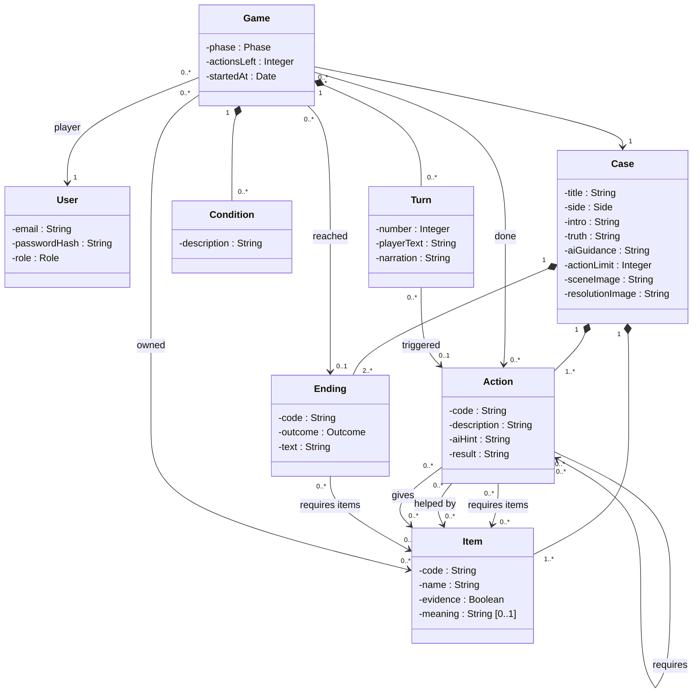
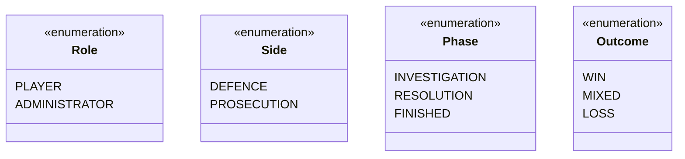

# Case Prompt: project analysis

> 13 November 2026 · Team of four: *names to add* · Idea, stack and host validated by the teacher. The game is in French; this document is in English. Its main purpose is for the team to agree on how the game works.

## 1. Concept

Case Prompt is a browser investigation game in two phases. In the **investigation**, the player sees a crime scene and types freely what he does; an AI game master judges whether the action is believable, triggers the interactions the scenario allows, and narrates the result. In the **resolution**, the player uses the evidence they collected to defend their client or accuse someone, depending on the case, and the story reaches one of several endings written in advance.

**Why it is not a wrapper:** the team writes each case by hand: the story, what really happened, what each piece of evidence means, every possible action and the endings. All of it is stored in the database. The AI narrates and decides *when* to trigger an action; it never invents one. The code checks every decision.

## 2. How a case is written

The team writes everything in advance. A case is one JSON file: the story, then three dictionaries keyed by id: actions, items and endings.

```json
{
  "title": "Death in the CEO's office",
  "side": "defence",
  "action_limit": 20,
  "story": {
    "intro": "The CEO was found dead in his office. Your client, his assistant, is accused.",
    "truth": "The finance director killed him after the CEO discovered the fraud. The knife was planted to frame the assistant.",
    "ai_guidance": "React to the player's theories as the truth allows. Never name the culprit and never point to a hidden object."
  },
  "actions": {
    "search_drawer": {
      "description": "A wooden desk with a single drawer.",
      "ai_hint": "Easy, the drawer is not locked.",
      "gives": ["key", "knife"],
      "result": "In the drawer: a small brass key and a knife."
    },
    "open_door": {
      "description": "The door of the archive room is locked.",
      "ai_hint": "Easy with the key. Without it, only a very convincing idea works.",
      "helped_by": ["key"],
      "result": "The door swings open."
    },
    "open_chest": {
      "description": "A chest in the archive room.",
      "requires": ["open_door"],
      "gives": ["letter"],
      "result": "Inside the chest, a crumpled letter."
    }
  },
  "items": {
    "key": { "name": "Brass key" },
    "knife": {
      "name": "Knife",
      "evidence": true,
      "meaning": "Planted: no blood on it, the wound does not match."
    },
    "letter": {
      "name": "Threatening letter",
      "evidence": true,
      "meaning": "Written by the finance director: proves the motive."
    }
  },
  "endings": {
    "acquitted": { "outcome": "win", "requires_items": ["letter"], "text": "…" },
    "doubt": { "outcome": "mixed", "requires_items": ["knife"], "text": "…" },
    "convicted": { "outcome": "loss", "text": "…" }
  }
}
```

| Field of the story or an item | Meaning | Used by |
| --- | --- | --- |
| `intro` | What the player knows at the start | Player and AI |
| `truth` | What really happened | AI |
| `ai_guidance` | How far the AI may guide the player | AI |
| `meaning` | What an item proves, or why it is a decoy | AI, once the player owns it |

The AI knows the truth so it can narrate consistently, react to the player's theories and play the resolution character. It is told never to reveal it.

| Field of an action | Meaning | Used by |
| --- | --- | --- |
| `description` | What the player can see | AI |
| `ai_hint` | How hard it is, what would make it believable | AI |
| `requires` | Actions that must already be done | Code |
| `requires_items` | Items the player must own | Code |
| `helped_by` | Items that make it easier but are not required | AI |
| `gives` | Items the player receives | Code |
| `result` | Text shown when the action succeeds | Shown as is |

**Two kinds of requirements.** `requires` and `requires_items` are **hard**: the code checks them, and an action whose requirements are not met is never even shown to the AI. `helped_by` and `ai_hint` are **soft**: the AI weighs them to judge whether the attempt is believable. A player without the key can still open the door if they convince the AI.

**Why a dictionary of ids rather than expressions** such as `"action_open_door==true"`:

- When a case is loaded, the code checks that every id it references exists. A typo is caught at once, not in the middle of a game.
- No mini-language to parse and no `eval`.
- Each id is unique by construction, and the order of actions does not matter.
- All requirements of an action must be met (AND). Two ways of reaching the same result are two actions, or one action with `helped_by`.

**No object states needed.** The door is open once `open_door` is done. Later, the scene image can show a layer for each action done.

## 3. A turn

### Game state, stored in the database

```json
{
  "phase": "investigation",
  "done": ["search_drawer"],
  "items": ["key", "knife"],
  "conditions": ["sprained ankle"],
  "actions_left": 14
}
```

### Investigation

1. The player types: "I kick the archive door open."
2. The server keeps only the actions not done yet whose hard requirements are met.
3. The server sends the model: the game-master role, the story (intro, truth, guidance), the scene, the game state with the meaning of the items owned, the available actions with their description and hint, the last five turns, and the player's text in quotes.
4. The model answers in a format enforced by a JSON schema:
   ```json
   {
     "action": null,
     "new_condition": "ankle more painful",
     "removed_condition": null,
     "narration": "You take a run-up, but your sprained ankle gives out before impact."
   }
   ```
5. The server checks the answer: `action` is `null` or one of the ids it sent, `removed_condition` is one the player has, lengths are bounded.
6. The engine applies the action (marks it done, gives the items), updates the conditions, saves the turn and counts it.
7. The player sees the narration, labelled "AI-generated", followed by the `result` text when an action succeeded.

The AI decides whether an attempt is **deserved**; persuading it ("I am a locksmith") is part of the game. The code decides what is **possible**. Conditions are hidden from the player and re-sent to the AI each turn, so it stays consistent ("with that ankle, you cannot kick hard enough").

### Resolution

1. When the action limit is reached, the game moves to the resolution: a second fixed image and one character played by the AI.
2. The player argues in free text, for the defence or the prosecution depending on the case.
3. The server keeps only the endings whose required items the player owns. Endings without requirements, such as losing, are always available.
4. The model answers `{ "ending": null | "<id>", "narration": "…" }` and chooses when the story reaches an ending.
5. The engine checks the id, records the ending and closes the game. The player can replay the case.

The prompt says how much of the evidence the player found, so the character can be openly sarcastic when they argue with almost nothing. The tone is set per case.

### When the AI fails (O5)

| Failure | Signal | Message to the player (in French) |
| --- | --- | --- |
| Timeout | 30 seconds or HTTP 408 | The game master is taking too long. Try again. |
| Provider down | HTTP 502 or 503 | The game master is unavailable. Your game is saved. |
| Credit exhausted | HTTP 402 | Cases are suspended for now. |
| Unusable answer | Answer fails the checks of step 5 | The game master got confused. Try again. |

The player's text stays in the field, the turn is not counted, and the evidence file stays readable. A fake AI provider, switched on by the administrator, produces each failure.

## 4. Class diagram (UML 2)





- The JSON file is how a case is **written**; the loader imports it into these tables, so every reference is checked by the database.
- Business entities for O2: Case, Action, Item, Ending, Game, Condition. Turn is the conversation with the model, so it does not count.
- Deleting an account deletes its games, with their turns and conditions (O7).

## 5. Requirements (MoSCoW)

**First milestone (M0), before anything else:** one local page with a placeholder image and a prompt field. The text goes to the server, which first returns a fixed fake answer, then calls the real model with a case written in the code. The page keeps the chat history and the game state in memory. No account, no database, no rules yet. Everything else is built around this page.

| No. | Requirement | MoSCoW | Covers |
| --- | --- | --- | --- |
| M0 | Image, prompt field, fake then real answer through the server, history and state on the page | Must, first | O1 |
| F1 | Case file format and loader that checks every id | Must | O2 |
| F2 | Investigation turn: available actions, model decision, checks, effects | Must | O1 |
| F3 | Hidden conditions, gained and lost, re-sent each turn | Must | O1 |
| F4 | Action limit, then switch to the resolution | Must | O1 |
| F5 | Resolution: the model picks an ending among those the evidence allows | Must | O1 |
| F6 | Evidence file and turn history, without AI | Must | O1 |
| F7 | Sign up, log in, each player sees only their own games | Must | O3 |
| F8 | Start, resume and replay a case | Must | O2 |
| F9 | Call log: date, player, model, tokens, cost, duration, success | Must | O4 |
| F10 | Admin dashboard: costs per day and per player | Must | O4 |
| F11 | Quota per plan, change a player's plan | Must | O4, O6 |
| F12 | Four failures, simulated by a fake provider | Must | O5 |
| F13 | Landing page with two plans | Must | O6 |
| F14 | Legal page, "AI-generated" label, account deletion | Must | O7 |
| F15 | Usable on a phone | Must | O3 |
| F16 | Second complete case | Should | O2 |
| F17 | Scene layers that follow the actions done | Should | |
| F18 | Characters to question during the investigation | Could | O1 |
| F19 | Animated or 3D scene (Three.js) | Could | |
| F20 | Narration streamed as it is generated | Could | |
| F21 | Several rooms per case, case editor, AI-generated cases | Won't | |

## 6. Technical choices

- **Stack**: Vue 3 and Vite, NestJS, PostgreSQL with Prisma, on the VPS with Docker Compose. One HTTP request per turn.
- **AI**: OpenRouter, called only by the server, with the key in an environment variable. The AI module has two implementations: OpenRouter and a fake provider used in development, tests and failure demos.
- **Model**: Mistral Small 3.2 to start, about $0.000135 per turn (estimate: 900 tokens in, 150 out). A 20-turn case costs well under one cent. To compare with Mistral Small 4 on the same test games.
- **Images**: generated once with an AI tool before release, stored as static files. Nothing is generated during play.
- **Security**: the AI knows the truth but only sees the available actions, never the hidden items or the endings out of reach. Even if a player tricks it into naming the culprit, they cannot win: endings require the evidence, and only the code gives items. Its answer is checked and never rendered as HTML; no personal data in the prompt; providers that keep prompts are excluded.

## 7. Planning

| Week | Goal |
| --- | --- |
| W2 · 10 Nov | **M0 running locally**, pipeline, case file format agreed |
| W3 · 17 Nov | First deployment, accounts, first case loaded, real model, call log |
| W4 · 24 Nov (review 1) | Playable investigation, evidence file, dashboard, quotas, failures |
| W5 · 1 Dec | Resolution and endings, prompt tuning, pricing from observed costs |
| W6 · 8 Dec | Landing page, legal page, account deletion, phone layout |
| W7 · 15 Dec (review 2) | Full case demo, report |
| Until 3 Jan | PDF report, journals, rehearsal for 5 January |

## 8. Risks

| Risk | Mitigation |
| --- | --- |
| Late start, review 1 on 24 November | M0 first; review 1 shows the investigation only |
| Deployment postponed | The brief expects production early and a live demo at review 1: deploy in week 3, even unfinished |
| Free models instead of the teacher's key | Fine for a first try only; ask the teacher for the group key |
| The AI is too easy or too hard to convince | Precise `ai_hint` per action, test games replayed after each prompt change |
| Writing the case takes longer than the code | One short case, frozen before week 4 |
| The AI reveals the truth when the player insists | Clear `ai_guidance`, test games that try to extract it; the win still requires the evidence |

## 9. Open questions

- Value of the action limit, and is the counter visible to the player?
- Can the player start the resolution before the limit?
- Does the resolution have its own turn limit?
- Who is the resolution character: judge, prosecutor, inspector? The same in every case?
- Can conditions disappear on their own, or only through the AI?
- Quota unit (turns or cases), and does a replay count?
- Story of the first case.
- How far may the AI guide the player: only react to their theories, or also nudge them when they are stuck?

## 10. Roles and task list

Four members, four areas. Each person owns one area, helps the others, and reviews their Pull Requests. The roles required by the brief (technical lead, QA, deployment) rotate weekly on top of this.

| Area | Owns | Their Pull Requests each week |
| --- | --- | --- |
| **Story** (S) | The case, the truth, actions, hints, endings, AI instructions, playtests | Case JSON files, prompt files, page texts |
| **Design** (D) | Visual identity, mock-ups, scene images, styling of the screens | Images, Vue components and CSS |
| **Back end and AI** (B) | Engine, AI module, database, quotas, failures | NestJS modules and tests |
| **Front end and DevOps** (F) | Vue screens, accounts, admin dashboard, pipeline, deployment | Vue screens, CI and deployment files |

The brief requires at least one significant Pull Request per person per week, so the story writer and the designer commit their work to the repository too.

### Together

| # | Task | Week | MoSCoW |
| --- | --- | --- | --- |
| A1 | Agree the case file format and the game state | W2 | Must |
| A2 | Protected `main`, issue board, one label per area | W2 | Must |
| A3 | Progress report for review 1 | W4 | Must |
| A4 | Progress report for review 2 | W7 | Must |
| A5 | PDF report, individual journals | W7 | Must |

### Story (S)

| # | Task | Week | MoSCoW |
| --- | --- | --- | --- |
| S1 | Case pitch: victim, client, suspects, what really happened | W2 | Must |
| S2 | Actions of the room with their requirements and hints | W2 | Must |
| S3 | Brief for the scene image: what must be visible and where | W2 | Must |
| S4 | Items, their meaning, the decoys | W3 | Must |
| S5 | First case as a JSON file that passes the loader | W3 | Must |
| S6 | AI instructions: game-master role, tone, `ai_guidance` (with B) | W3 | Must |
| S7 | Endings and the resolution character | W4 | Must |
| S8 | Weekly playtests: note what is too easy or too hard, adjust the hints | W4 to W7 | Must |
| S9 | Test games that try to extract the truth from the AI | W5 | Must |
| S10 | Texts of the landing page and the legal page | W6 | Must |
| S11 | Second case | W6 | Should |
| S12 | Report sections: scenario, prompts, what was abandoned | W7 | Must |

### Design (D)

| # | Task | Week | MoSCoW |
| --- | --- | --- | --- |
| D1 | Placeholder image for M0 | W2 | Must |
| D2 | Mock-up of the game screen on desktop and phone: scene, chat, evidence file | W2 | Must |
| D3 | Visual identity: logo, colours, fonts | W2 | Must |
| D4 | Final scene image, generated from the brief S3 | W3 | Must |
| D5 | Mock-ups: case list, login, resolution, ending | W3 | Must |
| D6 | Styling of the game screen in Vue | W4 | Must |
| D7 | Resolution image and character | W4 | Must |
| D8 | Mock-ups: admin dashboard, landing page with plans | W4 | Must |
| D9 | Landing page in Vue | W6 | Must |
| D10 | Phone layout and contrast check on every screen | W6 | Must |
| D11 | Scene layers that follow the actions done | W6 | Should |
| D12 | Slides for the 5 January presentation | W7 | Must |

### Back end and AI (B)

| # | Task | Week | MoSCoW |
| --- | --- | --- | --- |
| B1 | **M0**: NestJS route that answers a turn with a fixed fake answer | W2 | Must, first |
| B2 | AI module: interface, fake provider, OpenRouter provider | W2 | Must |
| B3 | Prisma schema and migrations | W3 | Must |
| B4 | Case loader: import the JSON, check every id | W3 | Must |
| B5 | Investigation turn: filter actions, prompt, JSON schema, checks, effects | W3 | Must |
| B6 | Call log | W3 | Must |
| B7 | Hidden conditions | W4 | Must |
| B8 | Four failures and the fake provider switch | W4 | Must |
| B9 | Quotas enforced on the server | W4 | Must |
| B10 | Action limit, resolution turn, ending filter | W5 | Must |
| B11 | Model comparison and cost measurement | W5 | Must |
| B12 | Engine tests with the fake provider | W3 to W6 | Must |

### Front end and DevOps (F)

| # | Task | Week | MoSCoW |
| --- | --- | --- | --- |
| F1 | **M0**: Vue page with the image, the prompt field, chat history and state in memory | W2 | Must, first |
| F2 | CI: lint and build on each Pull Request | W2 | Must |
| F3 | Deployment: Docker Compose, reverse proxy, HTTPS, deploy on `main` | W3 | Must |
| F4 | Sign-up, login, roles (server and screens) | W3 | Must |
| F5 | Per-player isolation, tested | W4 | Must |
| F6 | Game screen connected to the API, evidence file, history | W4 | Must |
| F7 | Case list: start, resume, replay | W4 | Must |
| F8 | Failure messages on screen, player text kept | W4 | Must |
| F9 | Admin dashboard: costs per day and per player, change a plan | W4 | Must |
| F10 | Resolution and ending screens | W5 | Must |
| F11 | Pricing from observed costs | W5 | Must |
| F12 | Account deletion and legal page | W6 | Must |

**Dependencies to watch:** S2 and D2 are needed for M0 to make sense; S3 comes before D4; S5 is needed before B5 can be tested on a real case; B5 is needed before F6.